# Azure Healthcare Application — Cloud Engineering Assessment Portfolio

> **Project context:** This portfolio documents work completed for a time-boxed cloud engineering assessment. The goal was to design a repeatable Azure environment for an API, a background worker, a SQL database, and document storage, with emphasis on private data access, identity-based security, reusable Terraform, and CI/CD validation.

## 1. Assessment goals

The assessment called for an Azure infrastructure design that protects data services from public access, supports private connectivity, uses reusable infrastructure-as-code, and documents security and cost trade-offs. The architecture was designed for development, QA, and production environments using environment-specific configuration.

## 2. Architecture summary

- **Networking:** virtual network, separate application and private-endpoint subnets, private DNS zones and VNet links.
- **Compute:** API and background-worker Web Apps, with networking configured according to each component's role.
- **Edge:** Azure Front Door as the public HTTPS entry point for the API, with origin routing and health checks.
- **Data:** Azure SQL Database and Blob Storage, intended to use private endpoints and disabled public network access.
- **Secrets and identity:** Key Vault network restrictions and a managed-identity/RBAC approach to reduce the need for stored credentials.
- **Automation:** GitHub Actions workflows for Terraform validation and plan review.

## 3. Screenshot evidence and explanations

Each screenshot below is selected from the supplied archive. Repeated copies of the same Private Endpoint view have been removed. Every entry explains what the image shows and why the configuration matters.

### Virtual Network

**What this shows:** The virtual network is the main network boundary for the application environment. It provides the address space used by the application integration and private endpoint subnets.

**Why it matters:** A clear VNet layout makes private connectivity and separation of application traffic from data-service access easier to design and review.

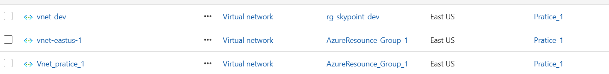

### Subnet layout

**What this shows:** The subnet view documents the planned separation between application integration and private endpoint resources. Each subnet has a specific role in the network design.

**Why it matters:** App Service VNet integration and private endpoints have different networking requirements, so separating these roles helps avoid misconfiguration and keeps the design maintainable.

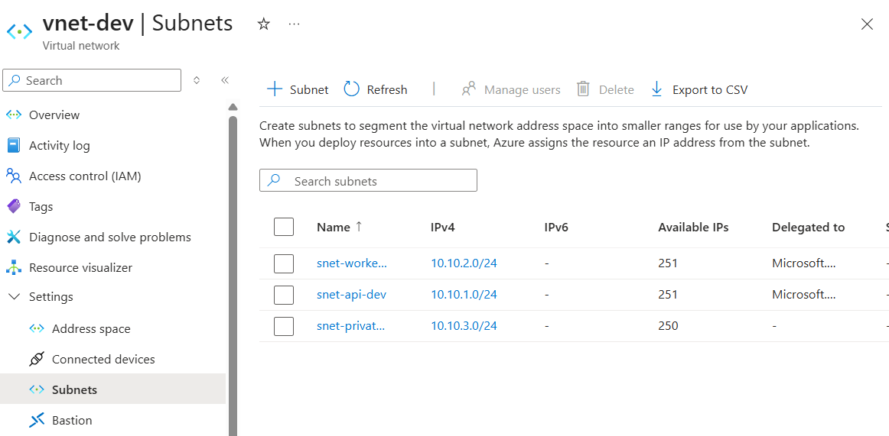

### Private Endpoints

**What this shows:** This screenshot provides an overview of private endpoint resources created or configured for the environment. Private endpoints provide private IP-based connectivity to supported Azure services.

**Why it matters:** For the database and document storage, private endpoints support the requirement to avoid direct public data-service access. The endpoint alone is not enough; DNS and service network settings must also be correct.

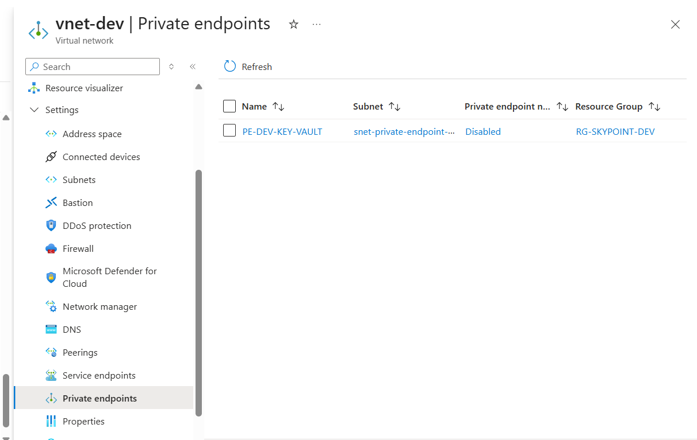

### Private Endpoint connection status

**What this shows:** This view records the private endpoint connection status for the selected Azure service. The status is important because a configured endpoint is not useful until the service connection is approved and operational.

**Why it matters:** Checking the connection state is part of troubleshooting private access. It should be considered together with DNS resolution, VNet links, and the target service's public-access setting.

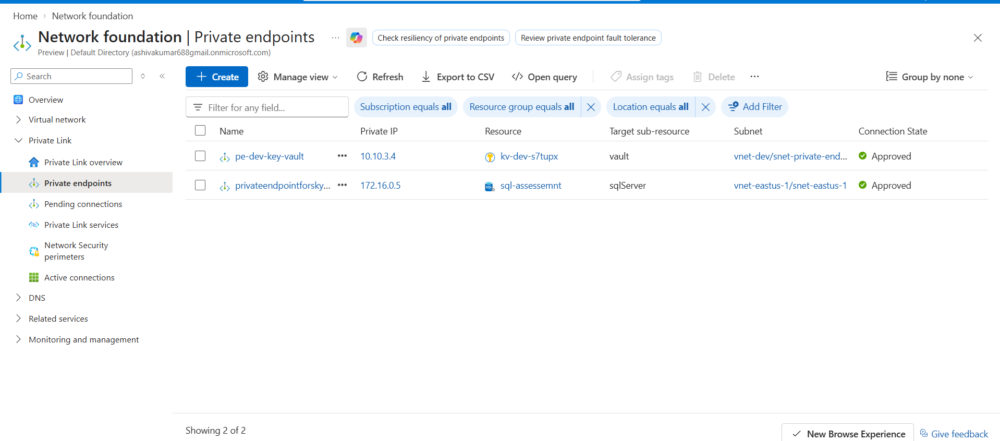

### Private DNS zones

**What this shows:** The screenshot documents the private DNS zones used for private service name resolution. The zones are intended to be linked to the application VNet.

**Why it matters:** Applications generally connect using service hostnames, so private DNS must resolve those names to private endpoint addresses. Without correct DNS, a private endpoint can exist while the application still cannot connect privately.

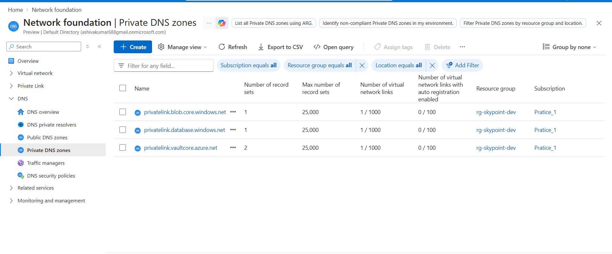

### SQL private DNS record

**What this shows:** This screenshot shows the SQL private DNS record used by the private endpoint design. It provides evidence of the DNS side of the database connectivity path.

**Why it matters:** Correct DNS records allow the application to use the standard SQL hostname while resolving it through the private network. The record should be verified against the endpoint's actual private IP and VNet DNS path.

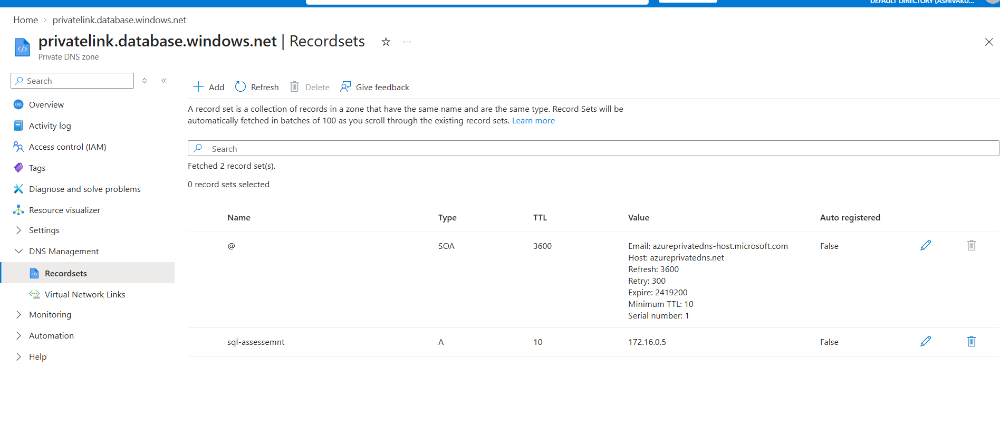

### SQL networking

**What this shows:** This view documents the SQL server networking configuration relevant to private connectivity. It should be read alongside the private endpoint and private DNS screenshots.

**Why it matters:** Database access needs multiple controls to align: the SQL server's network exposure, the private endpoint connection, and name resolution from the application environment.

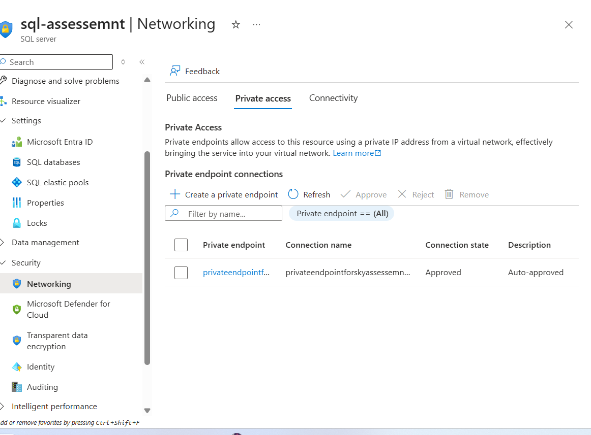

### SQL public access disabled

**What this shows:** This screenshot records the Azure SQL public network access setting as disabled. This is one of the central security requirements for the data layer in the assessment.

**Why it matters:** Disabling public network access reduces exposure of the database service and makes the private connectivity path the intended route. It does not alone prove the application can connect; end-to-end DNS and authentication tests are also needed.

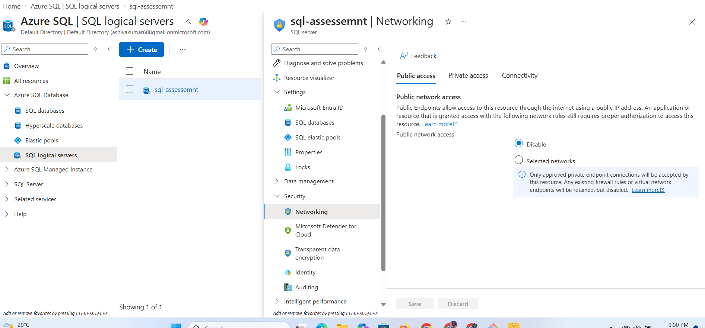

### Storage public access disabled

**What this shows:** This screenshot records the Storage Account network access configuration with public network access disabled. The account is intended to hold application documents in Blob Storage.

**Why it matters:** The design avoids exposing the document store directly to the internet and relies on private connectivity and identity-based permissions. Network restrictions and RBAC both need to be checked.

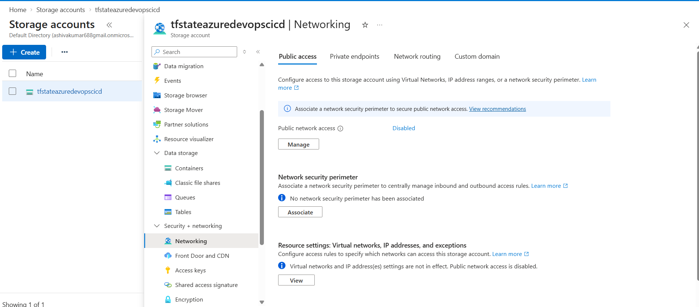

### API and worker access controls

**What this shows:** This view documents the inbound access restrictions configured for the API and background worker Web Apps. The API is intended to receive user traffic through the edge entry point, while the worker has no intended public caller.

**Why it matters:** Restricting direct origin access helps keep the application entry path controlled. The worker's lack of a public caller supports a deny-by-default approach for inbound traffic.

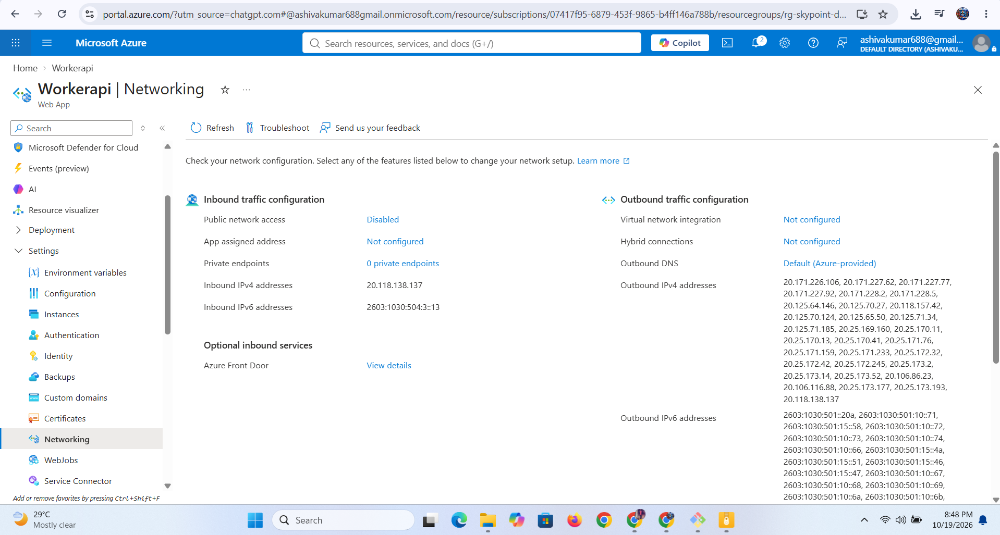

### API Web App networking

**What this shows:** This screenshot documents the API Web App's network settings. The architecture uses the API as the application entry service and configures outbound VNet integration for access to private data services.

**Why it matters:** VNet integration supports outbound private connectivity, but it does not by itself make the Web App's inbound hostname private. Inbound restrictions and the Front Door route must be considered separately.

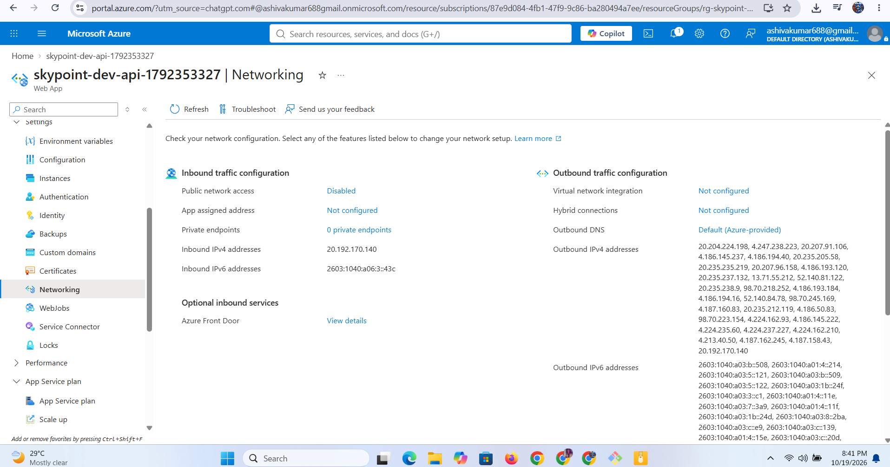

### App Service networking settings

**What this shows:** This view provides additional evidence of App Service networking settings for the application environment. It helps explain how the compute layer fits into the private-networking design.

**Why it matters:** The API and worker have different traffic needs, so the networking configuration should match their roles. The settings should be verified for both apps rather than assumed from a single Web App.

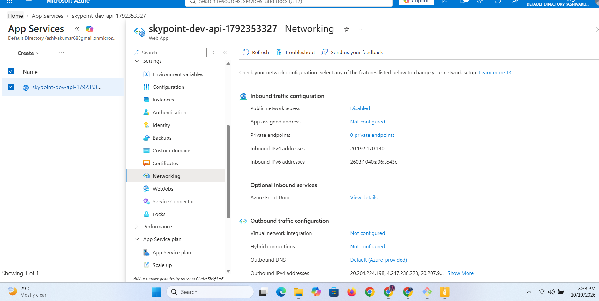

### Key Vault network restrictions

**What this shows:** This screenshot documents the Key Vault network restriction settings. Key Vault is included as a security component for secrets or other sensitive configuration that cannot be replaced by identity-based access.

**Why it matters:** Restricting network access reduces the paths from which the vault can be reached. It must be combined with appropriate identity permissions, auditing, and a verified private endpoint/DNS configuration.

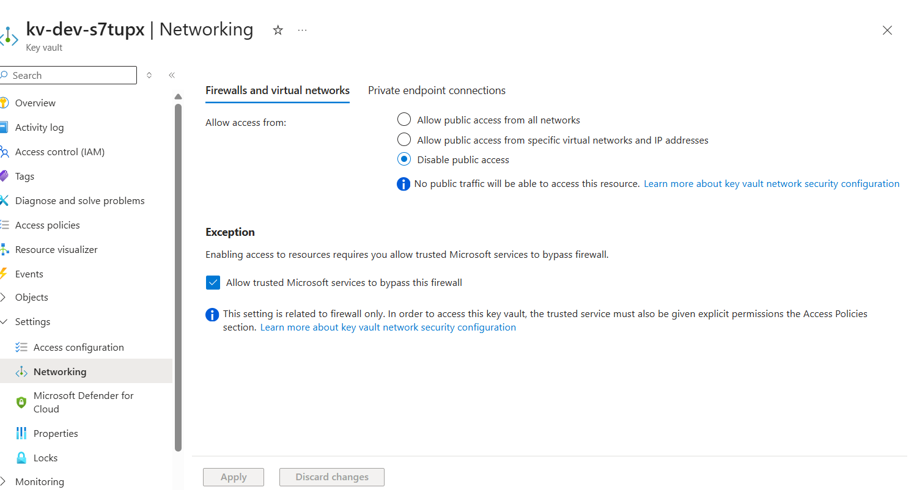

### Key Vault private link

**What this shows:** This screenshot documents the private-link configuration associated with Key Vault. It complements the vault's network restriction settings.

**Why it matters:** Private Link can provide a private network path to the vault, while DNS and authorization determine whether an application can use that path successfully. A configuration screenshot is not the same as a successful runtime access test.

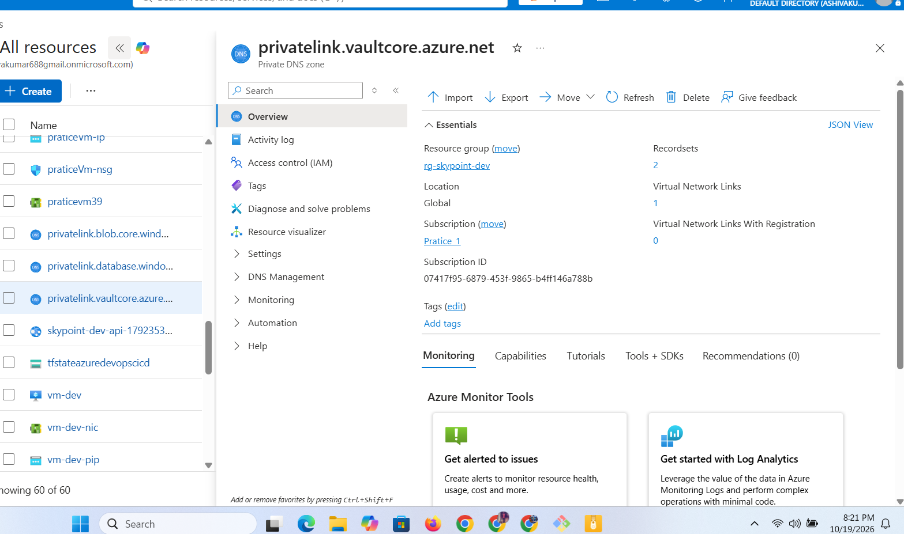

### Private Link resources

**What this shows:** This view provides additional evidence of the private-link resources used in the architecture. The private endpoint and DNS configuration work together to provide private access to managed Azure services.

**Why it matters:** Keeping the private-link components visible makes the design easier to audit and troubleshoot. The relevant connection state and DNS records should be checked for each target service.

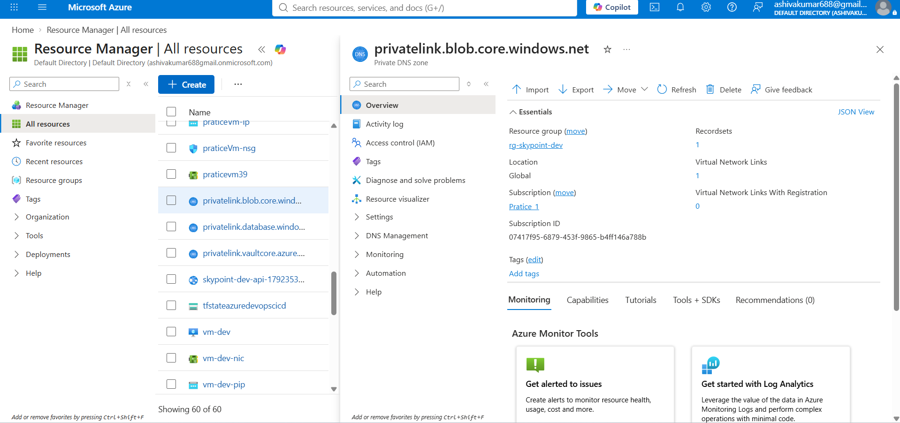

### API application resource

**What this shows:** This screenshot identifies the API application resource in the Azure environment. The API is the user-facing application component behind Azure Front Door.

**Why it matters:** The API and background worker have distinct responsibilities and ingress requirements. The application resource view helps tie the network configuration to the actual compute resource.

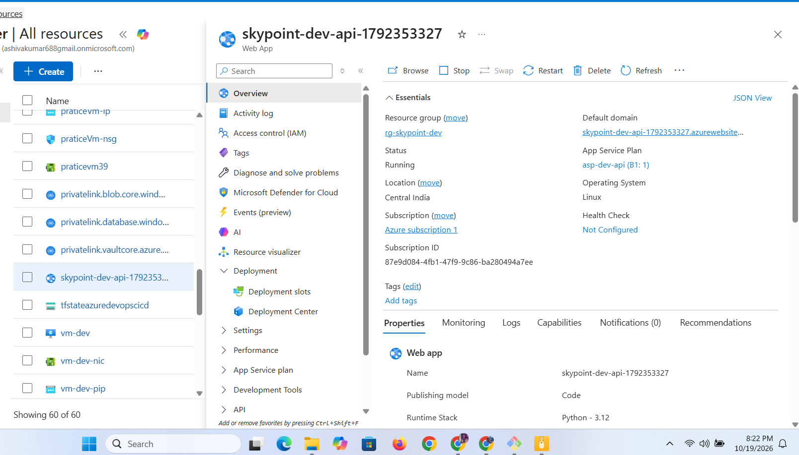

### Azure Front Door

**What this shows:** This screenshot documents the Azure Front Door resource used as the public HTTPS entry point for the API. The intended design uses origin health checks and routing to the Web App.

**Why it matters:** Front Door separates the public user entry point from the application origin and provides a place for routing and edge controls. The origin should also restrict direct access and validate that requests came through the intended Front Door profile.

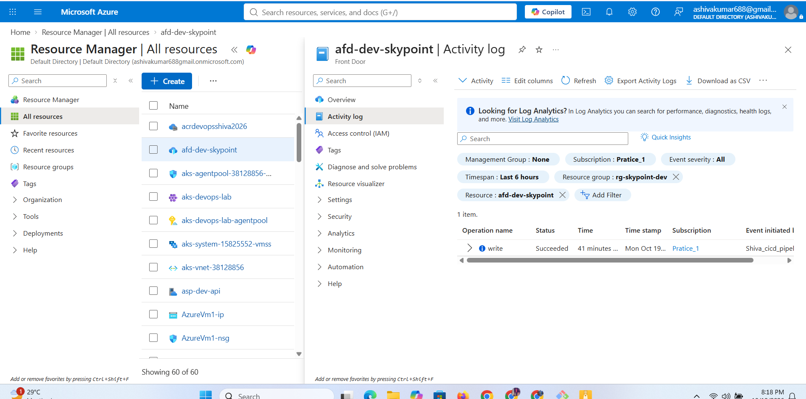

### GitHub Actions workflows

**What this shows:** This view documents the GitHub Actions workflows for the infrastructure repository. The workflows provide automation for validating Terraform changes and generating a plan.

**Why it matters:** Automated checks make infrastructure changes more repeatable and reviewable. Workflow configuration alone does not prove a deployment succeeded; the individual run result and logs must be interpreted separately.

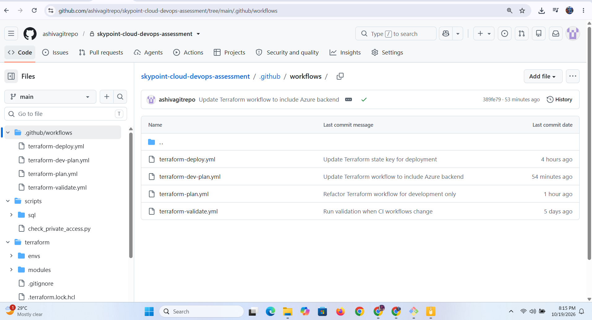

### Terraform configuration

**What this shows:** This screenshot provides evidence of the Terraform configuration used to describe the Azure infrastructure. The project separates resources into reusable modules and uses environment-specific variables.

**Why it matters:** Infrastructure as code makes the environment repeatable and reviewable, and helps keep dev, QA, and production structurally consistent. The code should be reviewed alongside validation output and the design decisions.

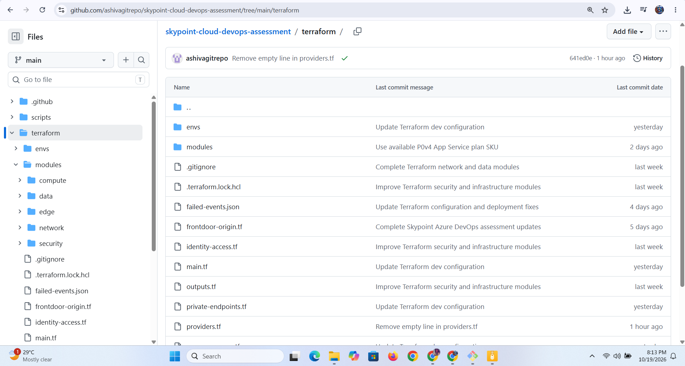

### Development Terraform plan

**What this shows:** This screenshot documents the development Terraform plan workflow or its output. A plan previews the changes Terraform intends to make before applying them.

**Why it matters:** Plan evidence supports review of proposed infrastructure changes and helps identify unexpected creates, updates, or deletes. A successful plan is not proof that Azure deployment completed successfully.

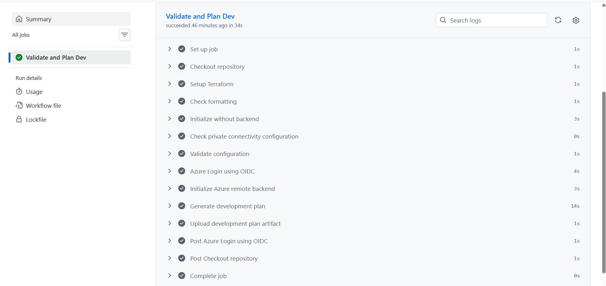

### Pull request validation

**What this shows:** This screenshot documents the pull-request validation workflow result. Validation checks are used to catch formatting, configuration, or policy-script issues before infrastructure changes are merged.

**Why it matters:** Pull-request checks make infrastructure changes easier to review and reduce avoidable errors. This evidence should be described as validation evidence, not as proof of a successful end-to-end deployment.

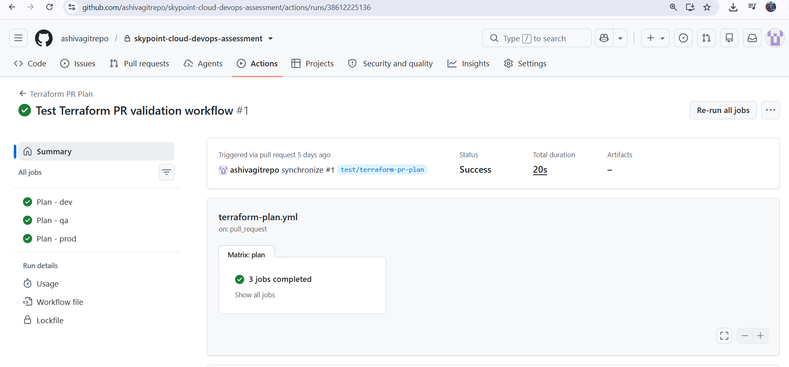

### Azure resource overview

**What this shows:** This screenshot provides a broader view of the Azure resources associated with the assessment environment. It helps place the networking, compute, edge, and data resources in context.

**Why it matters:** A resource overview is useful as an inventory, but individual settings still need their own evidence. For publication, review the visible resource names and identifiers to ensure they do not disclose information you want to keep private.

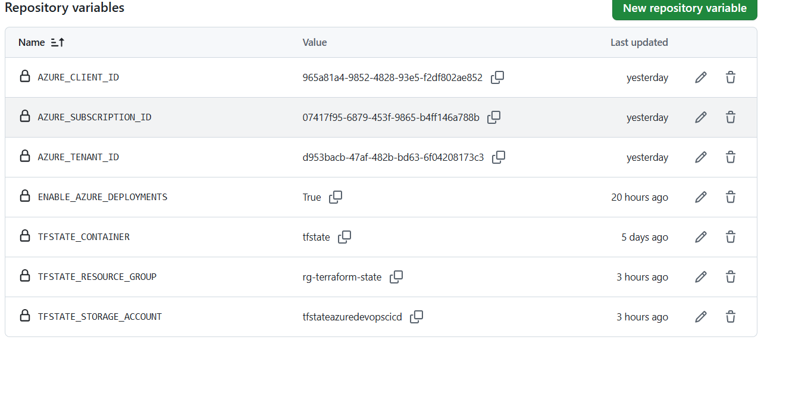

## 4. CI/CD and validation evidence

The GitHub Actions screenshots show workflow configuration and validation/plan evidence. A successful validation confirms that the configured checks passed for that run; a Terraform plan previews proposed changes. Neither is, by itself, proof that all resources were deployed successfully.

## 5. Implementation status and honest limitations

The infrastructure design and validation work were completed, but the attempted Azure deployment did not finish end-to-end. The apply encountered Azure service quota/region restrictions and an existing Front Door origin-group conflict. This portfolio therefore documents the design, configuration evidence, validation, and lessons learned; it does **not** claim a fully successful production deployment.

## 6. Key design decisions

- SQL and Storage are designed to disable public network access and use private endpoints.
- Private DNS zones and VNet links are required so application workloads resolve service hostnames to private endpoint addresses.
- Front Door is the public entry point for the API; the origin should restrict direct access and validate the expected Front Door profile.
- The background worker has no intended public caller, so inbound access should be deny-by-default.
- Managed identity and scoped RBAC reduce dependence on long-lived credentials and storage account keys.
- Terraform modules and environment-specific variable files help maintain a consistent dev/QA/prod structure.
- Terraform state, plan files, credentials, tokens, private keys, and sensitive `.tfvars` files must not be published.

